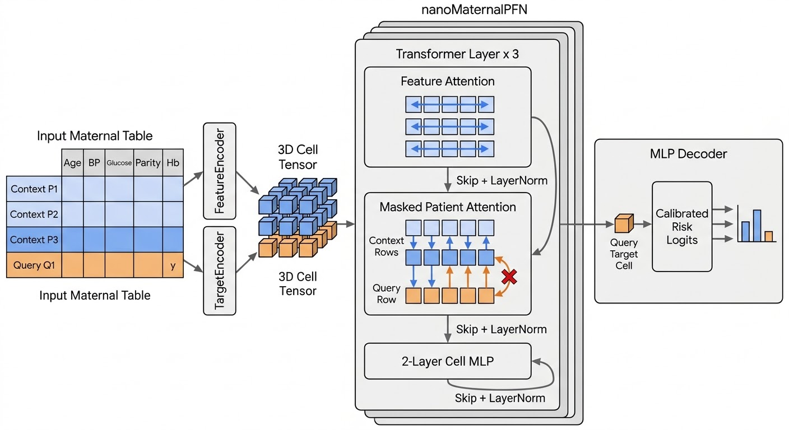
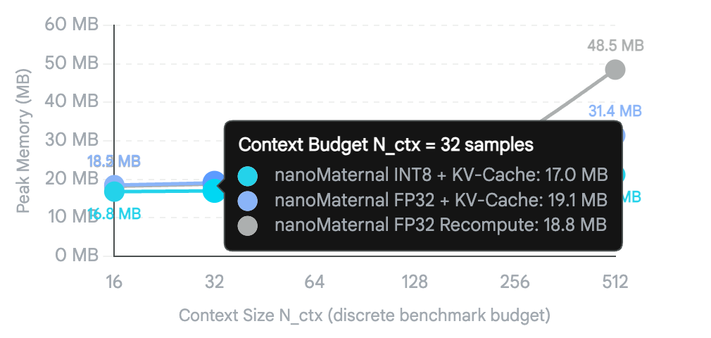

# nanoMaternalPFN

**A lightweight tabular foundation-model research framework for low-data maternal health prediction.**

nanoMaternalPFN studies whether a compact **Prior-Data Fitted Network (PFN)**, pretrained on a controllable **maternal-informed synthetic prior**, can transfer across small maternal/obstetric classification tasks while preserving predictive discrimination and probability calibration under resource constraints.

The core implementation uses **cell-wise alternating feature and patient attention**, a **missingness-aware input encoder**, and a masked context/query interface. The intended scientific contributions are the *prior design, controlled ablations, leakage-safe clinical evaluation, and real-device efficiency study*—not a claim of inventing the underlying PFN backbone.

> **Status: research implementation.** Code and automated unit tests are available. No finalized pretrained weights, clinical validation results, seven-dataset benchmark scores, reproducible INT8/KV-cache memory measurements, or Android performance claims are released. **Not for clinical diagnosis, triage, treatment or patient-facing use.**



## Highlights

- **Tiny tabular PFN**: the default 3-layer, 96-dimensional bi-attention backbone uses approximately 0.36 million parameters.
- **Native missing-value awareness**: encodes `[context-normalized observed value, missingness indicator]` for every feature cell. Normalization statistics are computed using labeled context rows only.
- **Strictly separated context and query**: patient attention uses labeled context rows as keys and values. Query rows cannot contaminate context or each other.
- **Maternal and generic task priors**: synthetic tasks incorporate exploratory BP, glucose, age, parity and hemoglobin nonlinearities, plus imperfect measurements and MCAR/MAR/MNAR-style patterns.
- **Low-data evaluation tooling**: source-verified CSV registry, duplicate-profile-grouped frozen splits, SHA-256 manifests, baselines and calibration metrics.
- **Edge research tooling**: CPU PyTorch latency profiling and an optional *full-context* ONNX export helper. True projected KV caching, validated INT8 mobile inference, energy profiling and ExecuTorch export remain future work.

## Model family

| Variant | Layers | Width | Heads | MLP width | Trainable parameters (3 classes) | Purpose |
| --- | ---: | ---: | ---: | ---: | ---: | --- |
| Tiny | 3 | 96 | 4 | 192 | 356,547 | Primary edge-focused research model |
| Small | 4 | 128 | 4 | 256 | 829,827 | Intermediate-scale comparison |
| Base | 6 | 192 | 6 | 384 | 2,750,403 | Higher-capacity ablation |

Counts are derived from the current PyTorch implementation in [`model.py`](src/nanomaternalpfn/model.py), including the three-class target encoder and classifier head. They may differ from earlier planning documents, which used a different encoder parameter-count convention.

## Installation

Python **3.10+** is required. A modern PyTorch build is recommended.

```bash
git clone https://github.com/HELPMUMCHATBOT/nanoMaternalPFN.git
cd nanoMaternalPFN
python -m pip install -e ".[test]"
pytest -q
```

To use optional export and boosting dependencies:

```bash
python -m pip install -e ".[edge,boosting]"
```

## Quickstart

Create a small **synthetic-only demonstration** (not a validated model):

```bash
python -m nanomaternalpfn.train --tier tiny --prior mixture --steps 100 \
  --out artifacts/checkpoints/tiny_maternal.pt
```

Load the checkpoint and make in-context predictions using synthetic records:

```python
import numpy as np
from nanomaternalpfn.classifier import NanoMaternalPFNClassifier
from nanomaternalpfn.priors.maternal_scm import sample_task

X, y, provenance = sample_task(
    n_rows=48, n_features=8, n_classes=3, prior="maternal", seed=7
)
model = NanoMaternalPFNClassifier(
    "artifacts/checkpoints/tiny_maternal.pt"
).fit(X[:32], y[:32])

probs = model.predict_proba(X[32:34])
print(provenance)  # synthetic, not a real clinical cohort
print(probs.shape) # (2, 3)
```

The model uses the supplied **labeled context** at inference time, without fitting new neural weights for the specific task. A 100-step checkpoint is for software smoke testing only.

## Architecture

For a table containing `N_context` labeled rows, `N_query` unlabeled rows and `F` feature columns:

1. **Feature encoder**: independently standardize observed scalar values using *only* context-row statistics, then embed normalized values and NaN indicators.
2. **Target encoder**: embed context labels; represent each query target using the empirical context class distribution.
3. **Alternating transformer block**: apply feature-wise self-attention, patient attention restricted to context keys/values, then a cell-wise two-layer GELU MLP, each with residual connections and LayerNorm.
4. **Query decoder**: read the final query target-cell embeddings and return class logits.

See [the implementation](src/nanomaternalpfn/model.py) and [model card](docs/model_card.md). **No published clinical-performance claim follows from architecture alone.**

### Completed synthetic-prior generation (10 November 2026)

Both complete research-scale synthetic prior archives have now been **generated and validated**:

| Prior archive | Tasks | Source | SHA-256 provenance |
| --- | ---: | --- | --- |
| `generic_prior_200k.h5` | 200,000 | Generic synthetic prior | [Manifest](artifacts/manifests/full_synthetic_priors_400k.json) |
| `maternal_mixture_prior_200k.h5` | 200,000 | 140,083 maternal / 59,917 generic tasks | [Manifest](artifacts/manifests/full_synthetic_priors_400k.json) |

Each archive is 3,095,890,480 bytes. HDF5 completion markers and selected table/label shapes were validated, along with replay at each 16–512 context budget. The large HDF5 bytes are **not stored in Git**; use the manifest to verify transferred archives. Full-scale GPU *training* on these tasks remains pending, and generated tasks do not establish clinical performance.

## Synthetic prior and pretraining

The repository separates **generic** synthetic table tasks from **maternal-shaped** tasks and offers a mixture configuration (70% maternal by default).

The exploratory maternal prior supports nonlinear hypertension, metabolic, obstetric-history and messy-data task families. Synthetic relationships are *design choices under investigation*, not established clinical probability models.

Generate a small synthetic HDF5 dump and a demonstration checkpoint:

```bash
python scripts/02_generate_prior_and_pretrain.py \
  --prior mixture --tables 100 --steps 10
```

Run a larger training job by adjusting `--steps`, batch size, device and model tier in [the trainer](src/nanomaternalpfn/train.py). Note: the current demo trainer samples tasks online; the HDF5 dump is a separate reproducibility artifact, **not an implemented HDF5-replay training loop**.

## Datasets

**No patient-level data are shipped**, and the repository deliberately avoids silently substituting simulated rows for unavailable public datasets. Governed datasets are not required by the current study plan.

The [dataset registry](src/nanomaternalpfn/data/registry.py) defines several open-dataset *candidates*. Each candidate must have verified provenance, licensing, target semantics, feature timing and file schema before inclusion in an official study.

Place a verified `uci_maternal_risk.csv` under `data/raw/` (target column: `RiskLevel`), then run:

```bash
python scripts/01_download_and_freeze_open7.py \
  --dataset uci_maternal_risk
```

Despite its historical name, this script currently **validates and freezes an existing local CSV; it does not download seven datasets**. The UCI Maternal Health Risk outcome is a risk-category proxy, not a prospectively adjudicated clinical endpoint. Repeated feature profiles are kept together across train/test splits, with conflicting labels audited rather than silently relabeled.

## Downstream evaluation

Evaluate classical baselines on an independently frozen test pool:

```bash
python scripts/03_run_2x2_transfer_benchmark.py \
  --manifest artifacts/manifests/uci_maternal_risk.json \
  --methods logistic random_forest
```

Include a pretrained PFN checkpoint with `--checkpoint ... --methods pfn logistic random_forest`. This evaluation assumes the checkpoint has completed the declared pretraining protocol and **does not imply it has done so**.

**Planned primary study:** Tiny vs. Base × generic vs. maternal prior, across 20 seeds and eligible labeled-context sizes `{16, 32, 64, 128, 256, 512}`. Report AUROC, Brier score, ECE, reliability curves, uncertainty, subgroup performance and hardware efficiency with transparent exclusions. The [experiment protocol](docs/experiment_protocol.md) records the intended design.

## EdgeBench

Run a PyTorch **CPU demonstration profiler**:

```bash
python scripts/04_run_edgebench_profiler.py
```

The originally supplied memory reference is reproduced **as an image only** below. Its points are not measured results of this committed implementation; they cannot establish an Android, INT8, KV-cache or memory-footprint claim.



The [edge benchmarking modules](src/nanomaternalpfn/edgebench/) include a CPU timing utility, a preliminary ONNX exporter, dynamic quantization exploration and an explicitly labeled non-KV context wrapper. Real context-KV reuse, ONNX parity tests, Android/XNNPACK measurements, peak native memory, device energy and clinical deployment testing remain outstanding.

## Repository layout

```text
configs/                         Model, prior and benchmark configurations
src/nanomaternalpfn/model.py      Missingness-aware alternating-attention PFN
src/nanomaternalpfn/priors/       Maternal and generic synthetic task generators
src/nanomaternalpfn/data/         Dataset registry and leakage-safe split freezing
src/nanomaternalpfn/evaluation/   Classical baselines, transfer curves and calibration
src/nanomaternalpfn/edgebench/    CPU profiling and preliminary export/compression
src/nanomaternalpfn/train.py      Synthetic task pretrainer
src/nanomaternalpfn/classifier.py In-context classifier wrapper
scripts/                         Reproduction commands
tests/                           Automated correctness tests
docs/                            Protocol, model card and reporting audits
assets/                           Original supplied PNG figures
```

## Reproducibility and research status

| Item | Status |
| --- | --- |
| PyTorch PFN and missingness handling | Implemented |
| Asymmetric context-only patient attention | Implemented; unit-tested |
| Synthetic generic / maternal task sampling | Implemented |
| Short synthetic training and checkpoint loading | Implemented; automated test |
| Grouped frozen splits with SHA-256 | Implemented; automated test |
| Classical baselines, AUROC, Brier and ECE | Implemented; real-world study not run |
| Complete 2×2 pretrained ablation checkpoints | **Not released** |
| Fully verified, licensed seven-task real-data portfolio | **Not assembled** |
| Mobile INT8 + true context KV caching | **Not implemented** |
| Verified Android latency/RAM/energy benchmarks | **Not measured** |
| Prospective external clinical validation | **Not conducted** |

Do not report unexecuted experiments as research results. Pretraining on synthetic tasks must remain entirely separate from source-verified real-world holdouts.


## Priority 1 and 2: data acquisition and research pretraining

The paper's original "Open-7" portfolio is a proposed task list, **not** seven verified independent maternal cohorts. The initial source audit is available in [Dataset Portfolio](docs/DATASET_PORTFOLIO.md). Use publicly obtainable sources only; the [acquisition script](scripts/01_acquire_open_sources.py) writes explicit per-source successes/failures and frozen SHA256 manifests, never synthetic patient substitutes.

```bash
python -m pip install -e ".[data,test]"
python scripts/01_acquire_open_sources.py
cat artifacts/manifests/open_portfolio_report.json
```

**Pretraining runs entirely on synthetic tasks** and is independent of real-dataset downloads. The research configuration is [study_2x2.yaml](configs/pretraining/study_2x2.yaml). It specifies 200,000 generated tasks *per prior*, generic and 70/30 maternal/generic, and Tiny/Base model tiers.

```bash
# Quick correctness check; four miniature smoke checkpoints, NOT a trained research study
python scripts/06_pretrain_study.py --smoke --device cpu

# Full 2x2 study: use a GPU-equipped machine with sufficient disk capacity
python scripts/06_pretrain_study.py --num-tables 200000 --steps 2500 \
  --batch-size 8 --device cuda
```

For interrupted runs the synthetic archive has a durable `completed` marker. To resume a particular checkpoint, use the [replay trainer](src/nanomaternalpfn/train_replay.py) `--resume` with the same prior archive, model, and optimizer settings. **Research claims require the full requested run to complete**; CI or smoke-test success does not establish clinical performance. The HDF5 generator and replay trainer support mixed 2/3-class synthetic tasks, 16–512 context budgets and variable feature counts.

Datasets with different endpoints are analyzed separately; the PhysioNet VAT GDM/delivery tasks share one cohort, and Pima is a *nonmaternal* transfer control. Neither counts as an independent additional maternal cohort.

## Open cohort expansion and AWS GPU pretraining

Two additional, independently collected public PhysioNet sources have been added as **candidate** tasks: the TPEHG term/preterm pregnancy cohort and CTU-UHB intrapartum cord-pH cohort. Source licensing, endpoint timing and exclusion of post-outcome features are described in [the A10G and cohort guide](docs/SAGEMAKER_G5_AND_OPEN_COHORTS.md). They are **not declared acquired** until the live acquisition job produces validated frozen manifests.

For SageMaker `ml.g5.2xlarge` (one 24 GB A10G), the intended four sequential Tiny/Base × generic/maternal-mixture training runs comprise 2,500 optimizer steps each. **No measured A10G runtime is claimed**. Benchmark an actual forward/backward/optimizer workload before allocating the full training job:

```bash
python scripts/07_benchmark_sagemaker_a10g.py --contexts 16 128 512 --tiers tiny base --batch-size 8
```

A cautious, unverified first-run planning allocation is 6–18 hours, with up to 24 hours reserved for long contexts, I/O and retrials. See the [GPU cost and memory guidance](docs/SAGEMAKER_G5_AND_OPEN_COHORTS.md) before launching.

## References

- [nanoTabPFN — educational bi-attention PFN implementation](https://github.com/automl/nanoTabPFN)
- [Hollmann et al. (2025), *Accurate predictions on small data with a tabular foundation model*](https://www.nature.com/articles/s41586-024-08328-6)
- [TRIPOD+AI reporting guidance](https://www.tripod-statement.org/)
- [MedARC CortexMAE — README presentation inspiration](https://github.com/MedARC-AI/CortexMAE)

## Citation and license

There is **no published nanoMaternalPFN paper or DOI** to cite yet; please link to this repository when referring to this implementation. An explicit project software license and dataset-specific redistribution permissions must be resolved before an official release. External model weights and datasets retain their own terms.

**Clinical scope:** research-only. No trained checkpoint in this repository is authorized or validated for care decisions.

## Measured paper evidence and manuscript (P1-P15)

The frozen eight-task, seven-source **exploratory** benchmark has been audited and reported without new training or invented patient-level outcomes. See [the complete measured manuscript](docs/paper/MANUSCRIPT.md), [statistical audit](docs/paper/STATISTICAL_REPORT.md), [source and reproducibility instructions](docs/paper/REPRODUCE.md), [clinical reporting audit](docs/paper/CLINICAL_REPORTING_AUDIT.md), and [P1-P15 implementation register](docs/paper/P1_P15_IMPLEMENTATION.md). Numbers are specific to the frozen ZIP and the official **TabPFN v2** comparison. Three-expert Tiny has the top *observed* macro AUROC, but the seven-source uncertainty interval crosses zero; neither clinical superiority nor independent confirmation is claimed. Do not confuse standalone ONNX latency/size with adaptive multi-expert performance.
