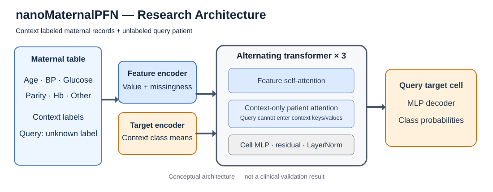

# nanoMaternalPFN

Research-only implementation of a missingness-aware, alternating feature/patient-attention prior-data fitted network for low-data tabular maternal-health tasks. **Not validated for diagnosis, triage, treatment or deployment to patients.** No pretrained model efficacy or mobile memory/latency result is claimed.



## Scope

- Feature encoder takes `[context-normalized value, missingness mask]`, fitting means/variances on labeled context rows only.
- Target encoder exposes context one-hot labels and pads query target columns with context class mean.
- Three repeating sublayers: feature self-attention, patient attention with **context-only keys and values**, and cell MLP. Decoder predicts query target logits; `n_classes` restricts binary vs. 3-class outputs.
- Synthetic maternal/general prior sampler includes nonlinear age, parity, hypertension and metabolic effects plus MCAR/MAR/MNAR-inspired artifacts. These are **simulation assumptions**, not validated clinical distributions.
- Real-data benchmarking requires source-verified local CSVs, patient-profile grouping, SHA256 frozen manifests, no government/DUA datasets by default, and no fabricated real-data fallback.
- Calibration (multiclass Brier, ECE), fairness-group summaries, baselines and reproducible transfer sweeps.
- CPU profiler measures observed latency; ONNX full-context exporter is optional. Mobile KV-cache, QAT, ExecuTorch, energy and Android benchmarking remain **unimplemented**, not evidenced by the supplied reference image.

## Quickstart

```bash
python -m pip install -e '.[test]'
pytest -q
python -m nanomaternalpfn.train --steps 100 --prior mixture --tier tiny
python scripts/04_run_edgebench_profiler.py
```

For a **real** dataset, obtain a license-compliant CSV first and put it in `data/raw/` using the filename in `registry.py`; verify its target column and provenance. The benchmark does not fetch or silently invent missing datasets.

```bash
python scripts/01_download_and_freeze_open7.py --dataset uci_maternal_risk
python scripts/03_run_2x2_transfer_benchmark.py --manifest artifacts/manifests/uci_maternal_risk.json --methods logistic random_forest
```

To include pretrained PFN, run training first and add `--checkpoint artifacts/checkpoints/tiny_maternal.pt --methods pfn logistic random_forest`. A model trained for only 100 synthetic steps is **not** a performance-validating pretraining run.

## Proposed experiments

Full study: 2x2 architecture/prior ablation (Tiny and Base × generic and maternal prior); 20 seeds; eligible context budgets 16–512; discrimination, calibration and efficiency metrics. Counts/benchmark scope are experimental plans until reproducible training and dataset verification have been completed. See [Experiment protocol](docs/experiment_protocol.md) and [Model card](docs/model_card.md).

## Provenance and reliability

The attached docs and images are *specifications/reference illustrations*. The memory plot labeled 16.8/17.0/18.8/19.1 MB etc. is **not reproduced here**. Executable model parameter counts for 3-class outputs: Tiny **356,547**, Small **829,827**, Base **2,750,403** (the supplied specifications contain inconsistent alternative totals). Exact parameter counts are checked against the executable model; no unverified theoretical formula is treated as authoritative. Synthetic pretraining and real test data are strictly separated. UCI risk levels are proxy labels and not prospective adjudicated medical outcomes. Contradictory labels for identical feature profiles are flagged and retained within the same split rather than silently rewritten by majority vote.

## Sources

- User-supplied nanoMaternalPFN technical audit, dataset/research blueprint, and two linked Google Docs (Nov 2026).
- [nanoTabPFN](https://github.com/automl/nanoTabPFN), Pfefferle et al. (2025)
- Hollmann et al., *Accurate predictions on small data with a tabular foundation model*, Nature (2025)
- Collins et al., TRIPOD+AI (2024) and PROBAST+AI (2025)

License status of any third-party model weights or datasets must be checked before redistribution. This code does not include clinical or personal patient data.
