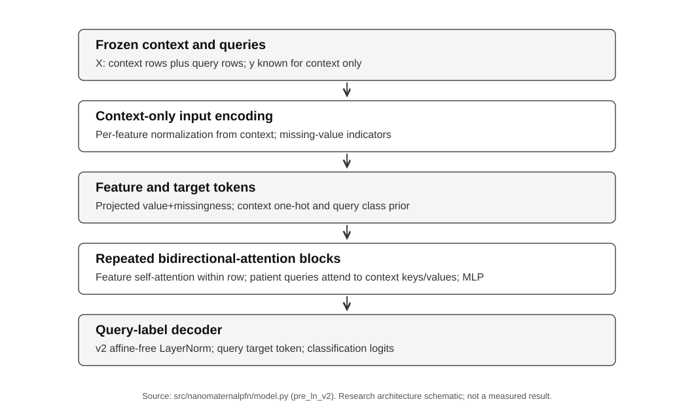
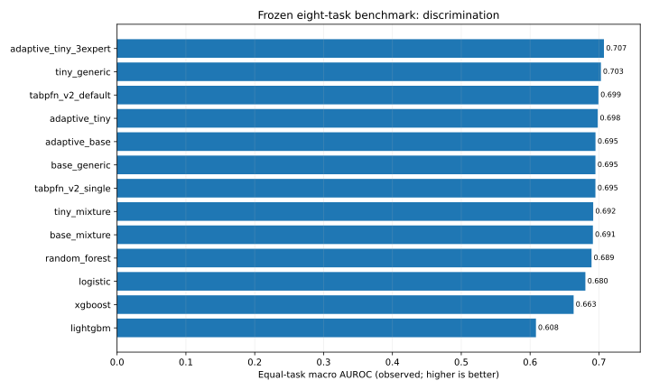
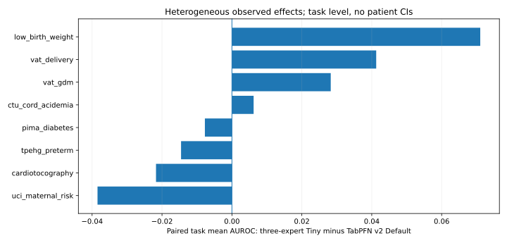
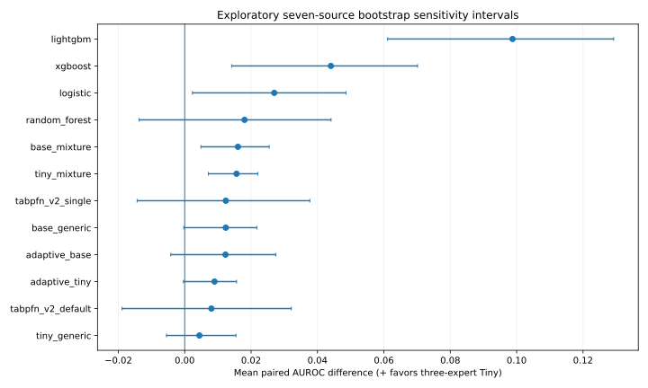

# nanoMaternalPFN: A Lightweight Tabular Foundation Model for Maternal Health Prediction

**Research manuscript — evidence-linked draft, 13 November 2026.**  
**Authors, affiliations, ethics determination and funding declarations: to be confirmed by the team.**  
**Study classification:** retrospective exploratory synthetic-to-real benchmark; not a validated clinical decision-support device.

## Abstract
**Background:** Clinical prediction from small heterogeneous tabular datasets is challenging, and deployable models may face tight resource limits. **Objective:** To characterize discrimination, calibration and computation of compact prior-data fitted networks pretrained on synthetic tables and evaluated on obstetric and related tasks. **Methods:** We analyzed eight frozen real-world prediction tasks from seven source cohorts using 671 matched context-draw evaluations per current model. Comparators comprised logistic regression, random forest, XGBoost, LightGBM, official TabPFN v2 single and default configurations, standalone nanoMaternalPFN variants, and two- or three-expert context-adaptive variants. Metrics were AUROC, accuracy, multiclass Brier and 15-bin expected calibration error. Paired AUROC differences were averaged within context and task and assessed using exploratory source-cluster resampling that kept both VAT outcomes together. **Results:** Three-expert Tiny achieved the highest observed equal-task macro AUROC (0.7073) compared with TabPFN v2 Default (0.6992); the paired difference was +0.0080 (95% seven-source bootstrap sensitivity interval -0.0189 to +0.0321; exact sign-flip p=0.578). TabPFN performed better on aggregate Brier and ECE15. **Conclusion:** The measured benchmark suggests a promising compact-model accuracy–resource trade-off, but it does not establish independent clinical superiority, equivalence, calibration advantage or deployment readiness.

## 1. Introduction
Clinical risk prediction frequently uses tabular measurements assembled from relatively small cohorts, often with missing values, inconsistent feature availability and shifting outcome definitions. Foundation-style approaches pretrained on synthetic tasks may reduce the need to fit neural-network weights on every new clinical dataset, but their accuracy, calibration and runtime should be assessed separately. A small model is not necessarily clinically reliable, and its resource requirements must correspond to the actual predictor evaluated.

Prior-data fitted networks (PFNs) learn to infer class probabilities conditional on labeled examples sampled from prior-generated tasks. TabPFN demonstrated the general potential of this strategy on small tabular datasets [1]. In maternal and fetal prediction research, small sample sizes and endpoint diversity make performance heterogeneity particularly important. Our study examines nanoMaternalPFN, a compact PFN family with generic and maternal-informed synthetic pretraining; the goal is to report what the locked benchmark actually measured rather than infer clinical utility from test-set rankings.

The contributions are: (i) eight-task, seven-source frozen-context evaluation; (ii) a transparent longitudinal comparison of historical v1 and current v2 models; (iii) a context-only two- and three-expert adaptive analysis; (iv) paired source-aware uncertainty and calibration assessment; and (v) separately recorded single-model ONNX and multi-expert CPU runtime results. Every statistical claim here is traceable to the frozen ZIP and audit scripts.

## 2. Materials and methods
### 2.1 Design and sources
The study retrospectively benchmarks eight already-inspected open prediction tasks. The two VAT outcomes derive from the same 133-pregnancy source cohort; they are distinct tasks but not independent participant populations. The Pima Diabetes dataset is a non-maternal metabolic transfer control. The UCI maternal-risk label is a categorized proxy rather than a prospectively adjudicated morbidity endpoint. Additional outcome-specific cautions and source URLs are recorded in `docs/DATASET_PORTFOLIO.md`.

**Evaluated tasks:** UCI Maternal Health Risk; PhysioNet VAT gestational diabetes; PhysioNet VAT delivery outcome; MASS low birth weight; UCI cardiotocography; Pima Diabetes; PhysioNet term/preterm electrohysterography; and CTU-UHB cord acidemia. The CTU-UHB threshold in the repository dataset adapter is a cord-pH classification proxy, not a prospective clinical treatment endpoint.

### 2.2 Models and synthetic pretraining
nanoMaternalPFN processes tabular feature and missingness information using feature-oriented and context-restricted patient attention, and predicts query labels from a labeled context. Training comprises generic synthetic prior tables and a maternal-mixture prior (70% maternal-shaped / 30% generic in expectation). The codebase distinguishes post-LN v1 and pre-LN v2 variants; v2 also changed class-index augmentation and training configuration. These historical changes occurred together, so the v1-to-v2 comparison is descriptive development history, **not** a controlled single-component causal ablation.

Adaptive Tiny combines the historical v1 Tiny Maternal-Mixture and v2 Tiny Maternal-Mixture checkpoints. The evaluated three-expert variant adds v2 Tiny Generic. Its expert weights and optional temperature are fitted by cross-validation on **labeled context only**; no query/test label is used for within-task adaptation. However, the *choice to test this three-expert configuration* was informed by previously inspected benchmark results, making its reported performance exploratory and subject to adaptive benchmark selection.

### 2.3 Benchmark comparators and frozen splits
The 13 current evaluated configurations are listed in Table 1. Classical baselines use the repository’s recorded defaults, not a clinical hyperparameter-optimization campaign: Logistic Regression (imputation, scaling, max_iter=1000), Random Forest (200 trees), XGBoost (200 estimators; histogram method) and LightGBM (200 estimators, otherwise library defaults). Official TabPFN v2 is explicitly selected with `ModelVersion.V2`, either one estimator or its default ensemble configuration. Predictive comparisons use the same frozen context/test indices and seeded draws where valid. Ineligible class-deficient contexts are recorded and uniformly omitted across methods.

The evidence archive contains 11,407 draw-level metric records over 17 historical/current configurations and 34 matched dataset/context cells per current method. There are 671 matched valid draws per current configuration. The primary summary comprises 1,632 rows for the original 12-current-method design; the additional three-expert arm contributes 136 rows. The ZIP also contains four historical v1 arms.

### 2.4 Endpoints and estimand
The metrics are AUROC (binary or one-vs-rest multiclass according to the recorded evaluation routine), accuracy, multiclass Brier score (sum over class probabilities, averaged over records) and 15-bin confidence-based expected calibration error (ECE15). Higher is better for AUROC/accuracy; lower is better for Brier/ECE15. Neither Brier nor ECE15 is a patient-level calibration curve, and neither directly estimates clinical benefit.

For each method, we first average valid draws at each dataset/context cell, then average eligible contexts within each task, then average the eight task means equally. The availability of larger contexts differs by dataset; cross-context comparisons are therefore not fixed-cohort learning curves. For pairwise results we join by the exact dataset, context and seed before taking differences. The directional effect is always positive if the three-expert model is better; for Brier/ECE15 the difference is reversed.

### 2.5 Uncertainty and multiplicity
Uncertainty analyses were **exploratory sensitivities** because model design and expert-pool selection followed earlier examination of these eight datasets. We resampled seven source groups with replacement (100,000 replicates), keeping both VAT endpoints together and preserving task weights. We also enumerated all 2^7 source-group sign flips under a symmetry assumption; p-values are descriptive, not independent confirmatory evidence. Twelve AUROC comparator tests were Holm adjusted. Repeated context draws re-use held-out patients, so a within-draw bootstrap cannot substitute for patient or source-level external uncertainty. No equivalence or noninferiority margin was prespecified.

### 2.6 Model efficiency and hardware
The paper reports two different profiled objects: a **standalone v2 Tiny Maternal-Mixture ONNX graph** (100 CPU query repetitions at each measured context) and warmed **PyTorch adaptive multi-expert predictors** (seven repetitions plus a separately reported context cross-validation fit cost). Baseline CPU timing was collected under a further routine with five repetitions. Cross-protocol ratios are not claimed as controlled head-to-head speedups. File size, combined checkpoint size, query time, context-fit time, total process RSS and incremental RSS remain separately identified. No Android, INT8 energy, mobile device RAM or prospective clinical performance is inferred.

## 3. Results
### 3.1 Source integrity
The evidence ZIP SHA-256 is `f67a41dab4d35b7cc09b9a0a353bbe09928833669ea9547678b804a973167a26`. All 256 manifest-listed members passed byte-count and SHA-256 verification. Recalculated raw-draw means matched archived summaries with maximum absolute discrepancy 3.33e-16; there were 0 draw-count mismatches. These checks verify the archive’s internal integrity, not independent patient-data provenance or model-weight authenticity.

### 3.2 Primary discrimination and calibration
**Table 1. Full measured macro leaderboard (equal task weight; eligible contexts).**
| method | auroc | brier | ece15 | accuracy |
| --- | --- | --- | --- | --- |
| adaptive_tiny_3expert | 0.7073 | 0.3358 | 0.1048 | 0.7703 |
| tiny_generic | 0.7028 | 0.3423 | 0.1153 | 0.7584 |
| tabpfn_v2_default | 0.6992 | 0.3165 | 0.0930 | 0.7864 |
| adaptive_tiny | 0.6983 | 0.3434 | 0.1057 | 0.7645 |
| adaptive_base | 0.6950 | 0.3385 | 0.0975 | 0.7670 |
| base_generic | 0.6949 | 0.3445 | 0.1254 | 0.7632 |
| tabpfn_v2_single | 0.6949 | 0.3211 | 0.0952 | 0.7841 |
| tiny_mixture | 0.6916 | 0.3504 | 0.1182 | 0.7602 |
| base_mixture | 0.6912 | 0.3433 | 0.1101 | 0.7591 |
| random_forest | 0.6892 | 0.3335 | 0.1093 | 0.7668 |
| logistic | 0.6803 | 0.3468 | 0.1221 | 0.7680 |
| xgboost | 0.6632 | 0.3940 | 0.1646 | 0.7472 |
| lightgbm | 0.6085 | 0.3652 | 0.1075 | 0.7562 |

The three-expert model ranked first by observed macro AUROC (0.7073) and led official TabPFN v2 Default (0.6992) by +0.0080. The seven-source percentile bootstrap interval was [-0.0189, +0.0321]; the exact two-sided source sign-flip result was p=0.578. The interval spans zero. Three-expert Tiny won 4/8 tasks and 3/7 source averages. No superiority or practical equivalence is established.

TabPFN v2 Default showed better observed aggregate calibration: three-expert Tiny Brier 0.3358 vs TabPFN 0.3165, and ECE15 0.1048 vs 0.0930. The three-expert Brier directional effect was -0.0192, and ECE15 was -0.0118 (positive would favor three-expert). Thus, AUROC is **not** an all-metric victory.

### 3.3 Low-data performance and heterogeneity
**Table 2. Macro leaderboard restricted to labeled contexts 16, 32 and 64.**
| method | auroc | brier | ece15 | accuracy |
| --- | --- | --- | --- | --- |
| adaptive_tiny_3expert | 0.6955 | 0.3453 | 0.1099 | 0.7646 |
| tiny_generic | 0.6894 | 0.3531 | 0.1189 | 0.7506 |
| adaptive_tiny | 0.6877 | 0.3523 | 0.1114 | 0.7606 |
| adaptive_base | 0.6848 | 0.3476 | 0.1031 | 0.7623 |
| tabpfn_v2_default | 0.6839 | 0.3341 | 0.0997 | 0.7748 |
| base_mixture | 0.6819 | 0.3509 | 0.1102 | 0.7564 |
| base_generic | 0.6813 | 0.3559 | 0.1273 | 0.7543 |
| tiny_mixture | 0.6807 | 0.3573 | 0.1172 | 0.7552 |
| tabpfn_v2_single | 0.6804 | 0.3387 | 0.1023 | 0.7727 |
| random_forest | 0.6726 | 0.3490 | 0.1141 | 0.7574 |
| logistic | 0.6591 | 0.3682 | 0.1327 | 0.7546 |
| xgboost | 0.6421 | 0.4117 | 0.1672 | 0.7306 |
| lightgbm | 0.5580 | 0.3845 | 0.0953 | 0.7377 |

Across those three context budgets, the three-expert model had observed AUROC 0.6955 compared with TabPFN v2 Default 0.6839, a paired difference of +0.0115 with source interval [-0.0131, +0.0343] and exact sign-flip p=0.469. This is descriptive low-data performance, not an independent significance result.

**Table 3. Paired task-level AUROC differences for three-expert Tiny vs TabPFN v2 Default.**
| dataset | AUROC difference (3-expert − TabPFN v2) |
| --- | --- |
| cardiotocography | -0.0217 |
| ctu_cord_acidemia | 0.0062 |
| low_birth_weight | 0.0710 |
| pima_diabetes | -0.0077 |
| tpehg_preterm | -0.0146 |
| uci_maternal_risk | -0.0385 |
| vat_delivery | 0.0413 |
| vat_gdm | 0.0283 |

**Table 4. By-context differences; larger context budgets evaluate fewer tasks.**
| contexts | n_tasks | n_sources | three_macro | other_macro | equal_task_effect |
| --- | --- | --- | --- | --- | --- |
| 16,32,64 | 8 | 7 | 0.6955 | 0.6839 | 0.0115 |
| 16 | 8 | 7 | 0.6631 | 0.6552 | 0.0079 |
| 32 | 8 | 7 | 0.7017 | 0.6864 | 0.0153 |
| 64 | 8 | 7 | 0.7216 | 0.7101 | 0.0114 |
| 128 | 5 | 5 | 0.7787 | 0.7860 | -0.0073 |
| 256 | 3 | 3 | 0.8617 | 0.8942 | -0.0325 |
| 512 | 2 | 2 | 0.8948 | 0.9242 | -0.0294 |
| all | 8 | 7 | 0.7073 | 0.6992 | 0.0080 |

### 3.4 Sensitivity analysis and multiple comparisons
**Table 5. Influential inclusion/exclusion choices (all post hoc, not alternative primary outcomes).**
| scenario | n_tasks | equal_task_effect | cohort_ci_lower | cohort_ci_upper |
| --- | --- | --- | --- | --- |
| all_tasks | 8 | 0.0080 | -0.0190 | 0.0322 |
| maternal_only_no_Pima | 7 | 0.0103 | -0.0209 | 0.0367 |
| exclude_VAT_pair | 6 | -0.0009 | -0.0238 | 0.0305 |
| exclude_low_birth_weight | 7 | -0.0010 | -0.0242 | 0.0198 |
| exclude_UCI_proxy | 7 | 0.0147 | -0.0123 | 0.0382 |
| strict_no_Pima_or_UCI | 6 | 0.0184 | -0.0133 | 0.0447 |

Excluding the VAT pair or the Low Birth Weight task changes the observed average lead to a slight deficit. This is evidence of dataset heterogeneity and argues against an unconditional generalization claim. Across twelve exploratory AUROC comparator contrasts, no comparison has Holm-adjusted p below 0.05. The source-cluster intervals are based on only seven convenience-source units and should be interpreted cautiously.

### 3.5 v1/v2 historical development and adaptive increment
**Table 6. v2 minus v1 measured macro AUROC by architectural/prior arm.**
| arm | v2_improvement_positive | v2_task_wins | cohort_ci_lower | cohort_ci_upper |
| --- | --- | --- | --- | --- |
| tiny_generic | 0.0149 | 5 | 0.0050 | 0.0248 |
| tiny_mixture | 0.0428 | 5 | -0.0167 | 0.1355 |
| base_generic | 0.2243 | 8 | 0.1333 | 0.3317 |
| base_mixture | 0.0289 | 7 | -0.0130 | 0.0757 |

Adding the third expert improved observed macro AUROC relative to the original two-expert Adaptive Tiny by +0.0090; however the cohort-bootstrap interval [-0.0004, +0.0156] crosses zero. The mixed architecture/prior changes between v1 and v2 mean that their longitudinal difference cannot uniquely establish the benefit of Pre-LN or class-permutation augmentation.

### 3.6 Deployment measurements
**Table 7. Measured, differently configured CPU efficiency results; no cross-object footprint substitution.**
| method | context | runtime | fit_cv_p50_ms | query_p50_ms | query_p99_ms | combined_checkpoint_mb | repeats |
| --- | --- | --- | --- | --- | --- | --- | --- |
| adaptive_tiny | 16 | PyTorch CPU | 22.700 | 5.663 | 5.838 | 2.899 | 7 |
| adaptive_tiny_3expert | 16 | PyTorch CPU | 31.913 | 7.886 | 8.307 | 4.348 | 7 |
| adaptive_tiny | 64 | PyTorch CPU | 90.882 | 12.087 | 12.720 | 2.899 | 7 |
| adaptive_tiny_3expert | 64 | PyTorch CPU | 130.579 | 17.760 | 20.819 | 4.348 | 7 |
| adaptive_tiny | 128 | PyTorch CPU | 264.132 | 19.056 | 20.398 | 2.899 | 7 |
| adaptive_tiny_3expert | 128 | PyTorch CPU | 396.552 | 25.308 | 31.151 | 4.348 | 7 |
| standalone_tiny_mixture_onnx | 16 | ONNX CPU | — | 0.943 | 0.965 | 1.520 | 100 |
| standalone_tiny_mixture_onnx | 64 | ONNX CPU | — | 2.649 | 2.923 | 1.522 | 100 |
| standalone_tiny_mixture_onnx | 128 | ONNX CPU | — | 5.098 | 5.856 | 1.525 | 100 |
| logistic | 16 | Baseline CPU | 1.705 | 0.350 | — | — | 5 |
| random_forest | 16 | Baseline CPU | 106.460 | 6.420 | — | — | 5 |
| xgboost | 16 | Baseline CPU | 5.611 | 0.156 | — | — | 5 |
| lightgbm | 16 | Baseline CPU | 1.376 | 0.267 | — | — | 5 |
| tabpfn_v2_single | 16 | Baseline CPU | 16.577 | 21.322 | — | — | 5 |
| tabpfn_v2_default | 16 | Baseline CPU | 28.033 | 138.119 | — | — | 5 |
| logistic | 64 | Baseline CPU | 1.681 | 0.332 | — | — | 5 |
| random_forest | 64 | Baseline CPU | 110.906 | 7.183 | — | — | 5 |
| xgboost | 64 | Baseline CPU | 8.260 | 0.165 | — | — | 5 |
| lightgbm | 64 | Baseline CPU | 4.636 | 0.276 | — | — | 5 |
| tabpfn_v2_single | 64 | Baseline CPU | 15.992 | 58.367 | — | — | 5 |
| tabpfn_v2_default | 64 | Baseline CPU | 28.491 | 339.887 | — | — | 5 |
| logistic | 128 | Baseline CPU | 1.656 | 0.328 | — | — | 5 |
| random_forest | 128 | Baseline CPU | 118.305 | 7.191 | — | — | 5 |
| xgboost | 128 | Baseline CPU | 15.272 | 0.176 | — | — | 5 |
| lightgbm | 128 | Baseline CPU | 7.926 | 0.293 | — | — | 5 |
| tabpfn_v2_single | 128 | Baseline CPU | 15.935 | 119.821 | — | — | 5 |
| tabpfn_v2_default | 128 | Baseline CPU | 32.252 | 714.984 | — | — | 5 |

At context 64, the three-expert PyTorch CPU system measured 17.760 ms median query time, 130.579 ms median context-CV fit time, and 4.348 MB combined checkpoint files. The standalone v2 Tiny Mixture ONNX graph measured 2.649 ms median query time and 1.522 MB graph size under a different implementation and repeat protocol. These properties belong to **different predictors** and must not be combined into one deployment point. The standalone ONNX process at context 64 reached 71.359 MB total process peak RSS, with 24.359 MB incremental peak over import baseline; it does not meet a 32 MB **total process** threshold. Adaptive multi-expert RSS was not measured in this archive.

## 4. Discussion
### 4.1 Interpretation
The benchmark suggests that a compact PFN family pretrained on synthetic tables can offer competitive discrimination under small labeled contexts. The three-expert adaptive model leads the tested methods by the reported point estimate, but its superiority over TabPFN v2 is unproven in source-aware sensitivity analyses. In particular, TabPFN offers better aggregate Brier, ECE15 and accuracy, and the three-expert improvement is sensitive to which tasks are included. The standalone Tiny variant is a more directly resource-conscious deployment option, but its lower parameter/graph size is not evidence of the adaptive system’s same efficiency.

### 4.2 Relation to existing work
The general PFN approach builds on TabPFN [1], which evaluates pretrained inference on heterogeneous tabular datasets. Our contribution is the documented maternal-informed synthetic-prior research program, low-context transfer and accurate resource accounting. Because benchmark-specific model choices were informed by earlier results, our comparisons should be regarded as exploratory internal/external transfer benchmarks rather than fresh external confirmation. These results motivate independent clinical and deployment studies, but those are outside the current measured evidence.

### 4.3 Baseline fairness
Under the recorded configurations, XGBoost and LightGBM trailed the best PFN approaches on equal-task macro AUROC, whereas Random Forest and Logistic Regression remained important strong baselines on several tasks. In contexts below the LightGBM default minimum child-sample threshold, tree splitting can be constrained; no fully tuned LightGBM or nested-tuned boosted-tree comparison was performed. The comparison is therefore against **the recorded configurations**, not a universal statement about gradient-boosted tree families.

### 4.4 Clinical and methodological limitations
The frozen archive lacks patient-level predictions and outcomes, precluding honest calculation of DeLong covariance, patient-level calibration curves, calibration intercept/slope, subgroup fairness measures, patient-level uncertainty and decision-curve clinical net benefit. The seven source cohorts are heterogeneous convenience samples rather than a representative sample of maternal health settings; the Pima control is nonmaternal, UCI risk uses proxy labels, and VAT outcomes are shared. Some datasets contain repeated feature profiles and limited independent contexts. Retrospective public-table performance does not establish future patient outcomes, causal benefit, transportability or safety in clinical workflows.

The three-expert idea and earlier v2 refinements were informed by previously inspected results, so formal tests are post hoc and vulnerable to benchmark-selection bias. The small number of source clusters makes bootstrap tails unstable and sign-flip tests coarse. Device timing does not include Android, cold-start downloads, energy, INT8 execution, quantized peak memory or clinical deployment conditions. Some timing routines used different repeat counts and interfaces. No claims about these unmeasured properties are made.

### 4.5 Reporting standards
This draft is aligned with the principles of TRIPOD+AI [2] and acknowledges the PROBAST+AI [3] domains. It is **not** a completed item-level external risk-of-bias adjudication. Missing data on eligibility decisions, patient-level class counts/prevalence, missingness rates, independent endpoint adjudication and subgroup results are flagged in `CLINICAL_REPORTING_AUDIT.md` rather than invented. No prospective risk-calibrated clinical decision threshold is proposed.

## 5. Conclusion
On eight previously inspected real-world prediction tasks from seven cohorts, three-expert nanoMaternalPFN Tiny produced the top observed macro AUROC among the evaluated methods, but source-aware statistical uncertainty did not establish superiority over official TabPFN v2 Default. Calibration was worse on the reported aggregate, and the three-expert system required more resources than the standalone Tiny ONNX graph. These findings support an exploratory accuracy–efficiency research contribution and motivate transparent independent clinical and hardware evaluations, not immediate patient-facing deployment.

## Data, code and reproducibility
The measurement source is the exact frozen `nanoMaternalPFN-paper_review_bundle.zip` whose SHA-256 is stated in §3.1. The full evidence archive contains no patient-level probability arrays. Audited CSVs, programmatic figures, source verification, source-cluster statistical routines and the full statistical report are organized under `docs/paper/` and `scripts/paper/`. Run `scripts/paper/run_paper_evidence.py --bundle PATH` to regenerate and verify; do not commit identifiable patient records or model credentials.

## Declarations requiring author sign-off
**Authors/contributions:** pending author confirmation.  **Funding:** not supplied in measured archive; author confirmation required.  **Ethics determination and data-use permissions:** verify source licenses and institutional requirements; no determination is asserted here.  **Conflicts of interest:** declarations pending.  **AI/model license constraints:** verify downstream licensing before distributing weights.  **Clinical regulatory status:** research only.

## References
[1] Hollmann N, Müller S, Purucker L, et al. Accurate predictions on small data with a tabular foundation model. *Nature*. 2025;637:319–326. https://doi.org/10.1038/s41586-024-08328-6

[2] Collins GS, Moons KGM, Dhiman P, et al. TRIPOD+AI statement: updated guidance for reporting clinical prediction models that use regression or machine learning methods. *BMJ*. 2024;385:e078378. https://doi.org/10.1136/bmj-2023-078378

[3] Moons KGM, Damen JAA, Kaul T, et al. PROBAST+AI: an updated quality, risk of bias, and applicability assessment tool. *BMJ*. 2025;388:e082505. https://doi.org/10.1136/bmj-2024-082505

